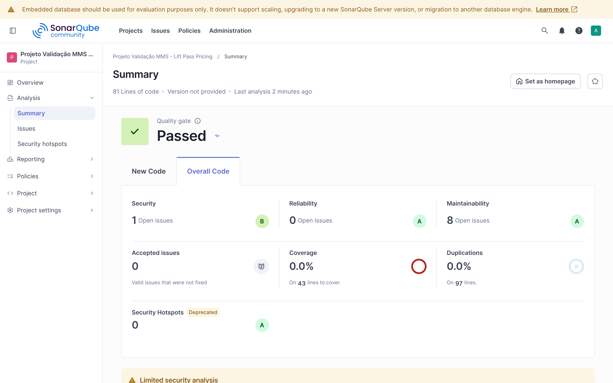
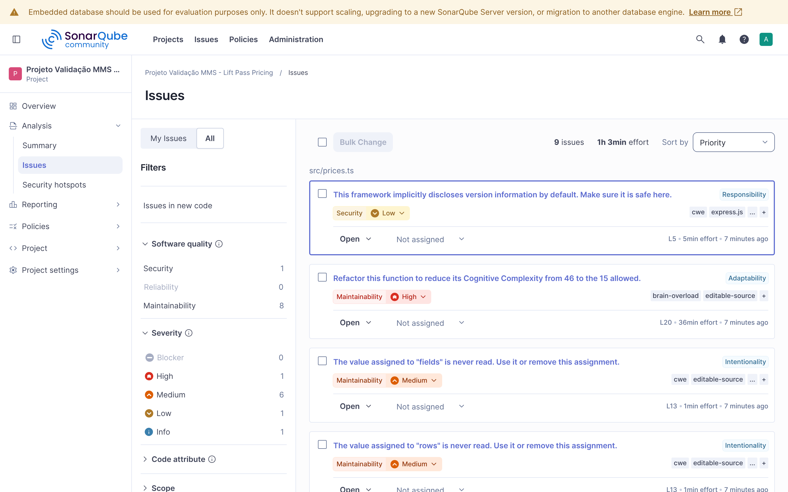

# Etapa 1: Diagnóstico do código legado

Este relatório registra o estado do código **antes** de qualquer alteração (tag `legado-original`). Nada do que está descrito aqui foi corrigido ainda. A ideia é saber exatamente onde está o problema antes de mexer.

## 1. Sistema analisado

O sistema é o kata **Lift Pass Pricing**, na versão em TypeScript. É uma API HTTP feita com Express que calcula o preço do passe de esqui (lift pass) de acordo com:

- o **tipo** do passe (`1jour` para o passe diurno, `night` para o noturno);
- a **idade** do esquiador (criança, adulto, idoso);
- a **data** de uso (feriado ou segunda-feira mudam o preço).

Arquivos:

| Arquivo | O que faz |
|---|---|
| `index.ts` | Sobe a API na porta 5010 (8 linhas). |
| `src/prices.ts` | Toda a aplicação: conexão com o banco, `PUT /prices` e `GET /prices` (87 linhas). |
| `database/initDatabase.sql` | Cria o banco `lift_pass` com as tabelas e os dados iniciais. |

Banco de dados (MySQL/MariaDB):

- `base_price`: preço base de cada tipo de passe (`1jour` = 35, `night` = 19).
- `holidays`: datas de feriado (`2019-02-18`, `2019-02-25` e `2019-03-04`).

Endpoints:

- `GET /prices?type=...&age=...&date=...` devolve `{"cost": N}`.
- `PUT /prices?type=...&cost=...` cria ou altera o preço base de um tipo.

**Pedido de evolução pendente:** o cliente quer consultar o preço de **vários passes de uma vez** (por exemplo, uma família inteira). Hoje isso não dá para fazer sem duplicar código, porque a regra de preço só existe dentro do handler HTTP, misturada com a leitura da query string, as consultas SQL e o `res.json`. Não existe uma função que receba "tipo, idade e data" e devolva um preço. Esse é o principal motivo para refatorar.

## 2. Como a análise foi feita

1. **SonarQube Community Build** (versão 26.11) rodando em Docker (`docker-compose.yml`), com o `sonar-scanner-cli` também em container.
2. **ESLint** com regras de métricas (`complexity`, `max-depth`, `max-statements`, `max-lines-per-function`, `prefer-const`, `no-unused-vars`), configuradas em [`eslint-metricas.config.mjs`](eslint-metricas.config.mjs) com limite 0, para o ESLint mostrar o valor de cada função.
3. **Leitura manual** do código, linha por linha.
4. **Testes exploratórios** no Node e chamando a API de verdade (com o MariaDB do `docker-compose.yml`), para confirmar os comportamentos estranhos antes de escrever sobre eles.

## 3. Métricas

### 3.1 Por função (ESLint)

| Função | Linhas | Linhas sem brancos e comentários | Comandos | Complexidade ciclomática | Aninhamento máximo |
|---|---|---|---|---|---|
| `GET /prices` (handler, linhas 20-83) | 64 | 57 | 30 | 15 | 5 níveis |
| `PUT /prices` (handler, linhas 10-19) | 10 | 9 | 4 | 1 | 0 |
| `createApp` (linhas 4-85) | 82 | 72 | 6 | 1 | 0 |

Os números de linhas são do `max-lines-per-function` do ESLint 10: a primeira coluna é a contagem padrão (conta tudo, inclusive linhas em branco e comentários) e a segunda usa `skipBlankLines` e `skipComments`. Eles ficaram um pouco diferentes dos valores de referência que eu tinha anotado antes (60, 7 e 73), porque a contagem muda conforme essas opções. Comandos, complexidade e aninhamento bateram exatamente.

Referências: o ESLint usa por padrão limite **20** de complexidade ciclomática e **4** de aninhamento (`max-depth`). O handler do `GET` passa do limite de aninhamento (5) e fica perto do de complexidade. O SonarQube é mais rígido: marca funções com **complexidade cognitiva acima de 15**, e o handler tem **46**, três vezes o permitido.

### 3.2 Projeto (SonarQube)



| Métrica | Valor |
|---|---|
| Linhas de código (ncloc) | 81 |
| Funções | 4 |
| Comandos | 44 |
| Complexidade ciclomática (total) | 18 |
| Complexidade cognitiva (total) | 46, toda no handler do `GET /prices` |
| Cobertura de testes | **0%** (43 linhas para cobrir, nenhum teste) |
| Duplicação (detecção de blocos do Sonar) | 0% |
| Issues abertas | 9 (8 de manutenibilidade, 1 de segurança, 0 de confiabilidade) |
| Débito técnico (manutenibilidade) | 58 min (1h03 somando a issue de segurança) |
| Razão de débito | 2,4% |
| Notas | Manutenibilidade A, Confiabilidade A, Segurança B |
| Quality Gate | Passed (ver observação abaixo) |

Issues apontadas pelo SonarQube em `src/prices.ts`:

| Linha | Regra | Severidade | Mensagem (resumida) |
|---|---|---|---|
| 20 | S3776 | Alta | Complexidade cognitiva 46, o permitido é 15 |
| 13 | S1854 | Média | Valor atribuído a `rows` nunca é lido |
| 13 | S1854 | Média | Valor atribuído a `fields` nunca é lido |
| 29, 58, 62, 72 | S6660 | Média | `if` aninhado dentro de `else` que poderia ser `else if` (4 ocorrências) |
| 54 | S1135 | Info | Completar o `TODO` |
| 5 | S5689 | Baixa (segurança) | O Express expõe a versão do framework no cabeçalho `X-Powered-By` |



**Observações sobre o SonarQube:**

- Nesta versão, o perfil de qualidade padrão para TypeScript é o **Sonar way core**, que só tem 199 regras. Com ele a análise apontou **apenas 1 issue** (a do `X-Powered-By`), sem nenhuma sobre complexidade. Para o diagnóstico eu troquei o perfil do projeto para o **Sonar way comprehensive** (perfil que já vem embutido, com 440 regras). Os números acima são com esse perfil.
- A nota A de manutenibilidade engana. Ela é calculada pela razão entre débito e tamanho do código, e como o projeto é pequeno (81 linhas) a razão fica baixa (2,4%), mesmo com uma função de complexidade cognitiva 46.
- O Quality Gate padrão ("Sonar way") só olha o **código novo** (condição: nenhuma issue nova). Na primeira análise não existe código novo, então ele passa mesmo com 9 issues abertas e 0% de cobertura. Isso vai ser tratado na Etapa 4.
- O Sonar não acusou as credenciais fixas nem os magic numbers, e a detecção de duplicação dele só pega blocos maiores. Esses pontos vieram da leitura manual e do ESLint.

### 3.3 Outros números

| O quê | Quantidade | Como contei |
|---|---|---|
| Acessos a `req.query` | 13 | `grep -o "req\.query" src/prices.ts \| wc -l` |
| Pontos de saída com `res.json` | 9 | `grep -o "res\.json" src/prices.ts \| wc -l` (1 no `PUT`, 8 no `GET`) |
| Conversões `as any` | 5 | linhas 26, 55, 62, 72 e 73 |
| Outras conversões (`as string`, `as mysql.RowDataPacket[]`) | 3 | linhas 32, 39 e 50 |
| Avisos de `prefer-const` | 7 | ESLint |
| Variáveis não usadas | 3 | ESLint: `rows` e `fields` (src/prices.ts:13) e `connection` (index.ts:4) |
| Testes automatizados | 0 | o kata só traz um exemplo vazio, que não foi copiado |

## 4. Code smells encontrados

| # | Smell | Onde (linhas de src/prices.ts) | Impacto |
|---|---|---|---|
| 1 | Long Method / God Function: todo o cálculo de preço fica dentro do handler HTTP | 20-83 | Difícil de ler e de testar. Não dá para reaproveitar a regra (bloqueia a consulta de vários passes). |
| 2 | Arrow Code: `if/else` aninhado em 5 níveis | 26-81 | Complexidade cognitiva 46. Para saber qual regra vale num caso é preciso seguir 5 níveis de `if`. |
| 3 | Mistura de camadas: HTTP (`req`/`res`), SQL e regra de negócio no mesmo bloco | 21-32 | Qualquer mudança num desses pontos mexe na mesma função. Não dá para testar a regra sem banco e sem servidor. |
| 4 | Magic numbers: `6`, `15`, `64`, `35`, `.7`, `.75`, `.4` | 26, 51, 55, 56, 62, 63, 72, 73, 74 | Os números não dizem o que significam (idade mínima, desconto de segunda, desconto de idoso...). Fácil errar ao alterar. |
| 5 | Código duplicado: `cost * (1 - reduction / 100)` e `res.json({cost: Math.ceil(...)})` | 59-67 | A mesma conta aparece 3 vezes. Uma mudança na regra de arredondamento precisa ser feita em vários lugares. |
| 6 | Primitive Obsession: idade e data são usadas direto como string da query | 26, 38, 39, 50, 55, 58, 62, 72, 73 | Sem conversão nem validação. Está por trás dos comportamentos 5.1, 5.2 e 5.3. |
| 7 | Credenciais fixas no código: usuário `root`, senha `mysql` | 7 | Senha versionada no Git e impossível de trocar por ambiente sem alterar o código. |
| 8 | Conexão com o banco criada dentro de `createApp`, sem ponto de injeção | 8 | Não dá para usar outro banco nem um dublê nos testes. |
| 9 | Variáveis não usadas: `rows`, `fields` | 13 | Ruído. Sugere que alguém esperava usar o retorno do `INSERT` e esqueceu. |
| 10 | `let` onde deveria ser `const` | 7, 36, 37, 39, 59, 63, 66 | Dá a entender que o valor muda, quando não muda. |
| 11 | Consulta da tabela inteira de feriados a cada requisição, e o loop não para (`break`) quando encontra | 30-48 | Desperdício: cada `GET` lê todos os feriados e percorre a lista toda, mesmo depois de achar a data. Também converte a mesma data da query a cada volta do loop. |
| 12 | TODO esquecido: `// TODO apply reduction for others` | 54 | Regra incompleta sem dono nem prazo (ver comportamento 4). |
| 13 | `res.json(result)` devolve o objeto que veio do banco direto | 76 | O formato da resposta depende da consulta SQL. Se alguém mudar o `SELECT`, a resposta da API muda junto. |

## 5. Comportamentos estranhos (possíveis bugs)

> **Importante:** nenhum destes comportamentos será corrigido agora. Na Etapa 2 eles serão **congelados** nos testes de caracterização exatamente como estão, para garantir que a refatoração da Etapa 3 não mude nada sem querer. Corrigir é uma decisão separada, que fica para depois da refatoração.

Todos foram confirmados chamando a API de verdade com o banco do `docker-compose.yml` e o Node 22.

### 5.1 O resultado depende do fuso horário do servidor

A data da query é convertida com `new Date(req.query.date)`. Uma data só com ano, mês e dia (`2019-02-18`) é interpretada como **meia-noite em UTC**, mas depois o código usa `getDay()` e `getDate()`, que trabalham no **fuso local** do servidor. Já os feriados vêm do banco como meia-noite no fuso local.

Teste no Node:

```bash
TZ=UTC node -e "const d = new Date('2019-02-18'); console.log(d.getDay(), d.getDate())"
TZ=America/Sao_Paulo node -e "const d = new Date('2019-02-18'); console.log(d.getDay(), d.getDate())"
```

| Fuso (`TZ`) | `getDay()` | `getDate()` | Interpretação |
|---|---|---|---|
| `UTC` | 1 (segunda) | 18 | Bate com o feriado de 18/02/2019 |
| `America/Sao_Paulo` | 0 (domingo) | 17 | Não bate: o código acha que é domingo, dia 17 |

Ou seja, rodando no Brasil (UTC-3) **nenhuma segunda ganha o desconto de 35%** e **nenhum feriado é reconhecido no dia certo**. Chamando a API nos dois fusos (passe `1jour`, idade 30):

| Data | Dia real | Resposta com `TZ=UTC` | Resposta com `TZ=America/Sao_Paulo` |
|---|---|---|---|
| 2019-02-11 | segunda | 23 (desconto de segunda) | 35 (sem desconto) |
| 2019-02-12 | terça | 35 | **23** (ganha o desconto de segunda) |
| 2019-02-18 | segunda, feriado | 35 (feriado, sem desconto) | 35 |
| 2019-02-19 | terça, dia seguinte ao feriado | 35 | 35 (o código acha que é a segunda 18, que é feriado) |

Na prática, em São Paulo o desconto de segunda vai para a **terça-feira**, e o feriado é reconhecido **um dia depois**. Idoso também muda: `age=70` em 11/02/2019 custa 18 em UTC e 27 em São Paulo.

### 5.2 Passe noturno sem idade sai de graça

`GET /prices?type=night` devolve `{"cost": 0}`. No ramo noturno (linha 72) o código testa `req.query.age >= 6`. Sem idade, `undefined >= 6` é `false`, e o código cai no `else` da linha 78, que devolve custo 0. No passe diurno a falta de idade é tratada como adulto (linha 58).

```bash
node -e "console.log(undefined >= 6)"   # false
```

### 5.3 Idade inválida: de graça no noturno, preço de adulto no diurno

Com `age=abc`, as comparações entre string não numérica e número sempre dão `false`:

```bash
node -e "console.log('abc' < 6, 'abc' > 64, 'abc' >= 6)"   # false false false
```

- `type=night&age=abc` devolve `{"cost": 0}` (mesmo caminho do item 5.2).
- `type=1jour&age=abc` devolve o preço de adulto (35, ou 23 numa segunda), porque falha em `< 6`, `< 15` e `> 64` e vai para o último `else`.

Nenhum dos dois casos dá erro de validação.

### 5.4 Criança não recebe o desconto de segunda-feira

Para menores de 15 anos (linha 55) o preço é `result.cost * .7` e a variável `reduction` é ignorada. É exatamente o caso do `TODO apply reduction for others` da linha 54. Resultado curioso: numa segunda-feira sem feriado (2019-02-11, em UTC) a criança paga **25** e o adulto paga **23**.

### 5.5 Tipo de passe inexistente derruba a API

`GET /prices?type=xyz` não encontra linha em `base_price`, então `result` fica `undefined`. Na linha 56, 63, 66, 74 ou 76 o código lê `result.cost` e lança `TypeError: Cannot read properties of undefined (reading 'cost')`.

Como o handler é uma função `async`, o erro vira uma promise rejeitada. O Express 4 não captura erros de promise, e a partir do Node 15 uma promise rejeitada sem tratamento **encerra o processo**. No teste, o `curl` recebeu "Empty reply from server" e todas as chamadas seguintes falharam com conexão recusada: a API caiu de vez por causa de uma única requisição.

(Exceção: `type=xyz` com idade menor que 6 devolve `{"cost": 0}` e não cai, porque esse `if` vem antes de qualquer acesso a `result`.)

### 5.6 `PUT /prices` não valida nada e responde vazio

- Aceita preço negativo ou zero: `PUT /prices?type=teste&cost=-50` grava -50 no banco, e o `GET` passa a devolver `{"cost": -50}`.
- Sempre responde `200 OK` com corpo vazio (`Content-Length: 0`), então quem chama não recebe confirmação do que foi gravado.
- Quando o valor não é aceito pelo banco (`cost=abc`, ou `cost` ausente, que viola o `NOT NULL`), o MariaDB devolve erro, ninguém trata, e o processo cai do mesmo jeito do item 5.5.
- Não existe nenhum tipo de autenticação: qualquer um pode mudar o preço.

## 6. Débito técnico priorizado

| Prioridade | Item | Por que |
|---|---|---|
| Alta | Nenhum teste automatizado (cobertura 0%) | Sem rede de proteção, qualquer refatoração é um risco. É o primeiro passo (Etapa 2). |
| Alta | Regra de preço acoplada ao HTTP e ao SQL | Impede reaproveitar o cálculo e **bloqueia a nova funcionalidade** (preço de vários passes). |
| Alta | Bug do fuso horário | Afeta o **preço cobrado**: no Brasil o desconto vai para o dia errado. |
| Média | Aninhamento de 5 níveis e código duplicado | Complexidade cognitiva 46. Fonte provável de novos bugs quando a regra mudar. |
| Média | Magic numbers e uso de primitivos (idade e data como string) | Regras sem nome e sem validação. Causa direta dos itens 5.2 e 5.3. |
| Média | Credenciais fixas no código | Senha no repositório e configuração presa ao código. |
| Baixa | `let` no lugar de `const`, variáveis não usadas, TODO esquecido | Limpeza simples, sem risco, que sai junto com a refatoração. |
| Baixa | Consulta de todos os feriados a cada requisição | Hoje a tabela tem 3 linhas, então o custo é pequeno. Vale corrigir quando separar o acesso ao banco. |

**Dependências desatualizadas:** o `package.json` usa Mocha 6, ts-node 8, SuperTest 4 e TypeScript 4.8, e o `npm install` já mostra aviso de pacote obsoleto (`debug@3.2.6`). Além disso o campo `"main": "index.js"` aponta para um arquivo que não existe, e o Node avisa isso ao subir a API. As dependências serão atualizadas na **Etapa 4**, junto com a pipeline, para a atualização também ficar protegida pelos testes.

## 7. Plano para as próximas etapas

**Etapa 2: Blindagem.** Escrever testes de caracterização na camada HTTP, chamando a API com o banco real (MariaDB do Docker Compose). Cobrir todas as combinações de tipo de passe, faixa de idade (sem idade, menor de 6, de 6 a 14, de 15 a 64, acima de 64, inválida), feriado e segunda-feira, **incluindo os comportamentos estranhos da seção 5**, com o resultado que o sistema dá hoje. O fuso horário será fixado nos testes para o resultado ser determinístico em qualquer máquina.

**Etapa 3: Refatoração.** Com os testes passando, separar o código em:

- `PricingLogic`: a regra de preço pura, sem HTTP nem SQL, recebendo tipo, idade e data;
- `PricingDao`: o acesso ao banco (preço base e feriados).

Também dar nome às regras (desconto de criança, de idoso, de segunda-feira), tirar os magic numbers e o aninhamento. A migração será feita com **Strangler Fig**: um endpoint novo usando a lógica nova, enquanto o endpoint antigo continua respondendo, até que o antigo possa ser desligado. A nova lógica permite atender o pedido de consultar vários passes de uma vez.

**Etapa 4: Automação.** Pipeline no GitHub Actions que sobe o MariaDB, roda os testes e envia a análise para o SonarQube, com um Quality Gate que **barra o merge** se as condições não forem atendidas.

## 8. Como reproduzir a análise

Pré-requisitos: Docker e Node.js 18+.

1. Subir o SonarQube:

   ```bash
   npm run sonar:up
   ```

2. Abrir http://localhost:9000, entrar com `admin` / `admin` e trocar a senha quando for pedido.
3. Criar um projeto manual (**Create a local project**) com a chave `projeto-validacao-mms` e branch principal `main`.
4. Em **Project Settings > Quality Profiles**, trocar o perfil de TypeScript e de JavaScript para **Sonar way comprehensive** (com o perfil padrão quase nada aparece, ver seção 3.2).
5. Gerar um token em **My Account > Security** (ou na tela de configuração do projeto, opção "Locally").
6. Rodar a análise:

   ```bash
   SONAR_TOKEN=<token> npm run sonar:scan
   ```

7. Ver o resultado no painel do projeto.

Para as métricas do ESLint (instala o ESLint só na pasta local, sem alterar o `package.json`):

```bash
npm install
npm install --no-save eslint@10 @typescript-eslint/parser@8
npx eslint -c docs/eslint-metricas.config.mjs src/prices.ts index.ts
```

Para repetir os testes exploratórios da seção 5:

```bash
npm run db:up
TZ=UTC npm start
```

E, em outro terminal, chamar por exemplo `curl "http://localhost:5010/prices?type=1jour&age=30&date=2019-02-11"`. Para o caso do fuso, parar a API e subir de novo com `TZ=America/Sao_Paulo npm start`.
