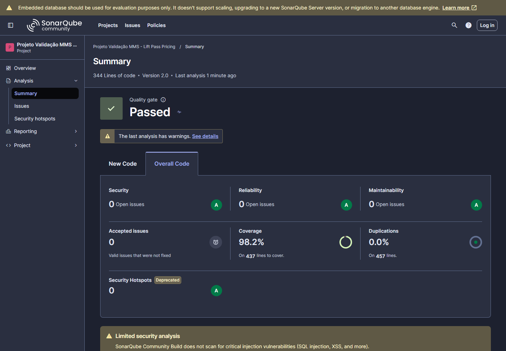

# Etapa 4: Automação com CI/CD e Quality Gate

As etapas anteriores deixaram o código testado e limpo. Esta etapa garante que ele **continue assim**: toda mudança passa automaticamente pelas mesmas verificações, e uma mudança que piore a qualidade é barrada antes de entrar na `main`.

## 1. O Quality Gate

Quality Gate é um conjunto de condições que o código precisa cumprir para ser aceito. Aqui ele tem quatro partes, e todas precisam passar:

| Verificação | Comando | O que barra | Por que esse limite |
|---|---|---|---|
| Lint de qualidade | `npm run lint` | Complexidade ciclomática acima de 8, aninhamento acima de 2 níveis, função com mais de 40 linhas ou 15 comandos, mais de 4 parâmetros, `any`, `let` que deveria ser `const`, variável não usada | O handler legado tinha complexidade 15 e 5 níveis de aninhamento. O código refatorado tem no máximo 7 e 1. O limite fica entre os dois: o código atual passa com folga e o legado seria barrado |
| Checagem de tipos | `npm run typecheck` | Qualquer erro de tipo do TypeScript em modo estrito | O legado usava `as any` 5 vezes para fugir da checagem |
| Testes | `npm test` | Qualquer teste falhando (89 testes) | Os testes de caracterização garantem que o preço cobrado não muda sem querer |
| Cobertura mínima | `npm run test:coverage` | Cobertura abaixo de 95% das linhas e 90% dos ramos | Hoje a cobertura é 100% das linhas. O limite deixa uma pequena margem, mas impede código novo sem teste |

O arquivo de regras do lint é o [`eslint.config.mjs`](../eslint.config.mjs) e o da cobertura é o [`.c8rc.json`](../.c8rc.json).

**O mesmo Quality Gate roda na máquina do desenvolvedor**, com um único comando:

```bash
npm run quality
```

**Prova de que as regras pegam código ruim:** o comando abaixo aplica as regras de lint atuais ao código legado original (tirado da tag `legado-original`) e mostra **27 erros**: complexidade 15, aninhamento de 5 níveis, 5 `any` e 7 `let` que deveriam ser `const`. Ou seja, se o código legado fosse enviado hoje, a pipeline o barraria.

```bash
npm run lint:legado
```

## 2. A pipeline

A pipeline fica em [`.github/workflows/ci.yml`](../.github/workflows/ci.yml) e roda no **GitHub Actions** a cada `push` na `main` e a cada **pull request**. Os passos:

1. Baixa o código e instala o Node.js 24.
2. Instala as dependências com `npm ci`, usando exatamente as versões do `package-lock.json`.
3. Roda o lint de qualidade.
4. Roda a checagem de tipos.
5. Sobe o MariaDB com o **mesmo `docker-compose.yml`** usado localmente (`npm run db:up`).
6. Roda os 89 testes com a cobertura mínima.
7. Guarda o relatório de cobertura como artefato da execução.
8. Envia a análise para o SonarCloud e espera o Quality Gate dele (opcional, ver seção 4).

Se qualquer passo falhar, a execução fica vermelha e as próximas etapas não rodam.

O ponto principal é que **a pipeline roda os mesmos comandos que o desenvolvedor roda na máquina**. Não existe "na minha máquina funciona": se `npm run quality` passa localmente, passa no CI, e vice-versa.

## 3. Barrar o merge na `main`

A pipeline sozinha só avisa. Para ela **impedir** o merge, a `main` precisa de uma regra de proteção no GitHub. Passo a passo (feito uma vez, pelo dono do repositório):

1. No repositório, abrir **Settings > Branches** (ou **Settings > Rules > Rulesets**).
2. Clicar em **Add branch protection rule** (ou **Add classic branch protection rule**).
3. Em **Branch name pattern**, digitar `main`.
4. Marcar **Require a pull request before merging**.
5. Marcar **Require status checks to pass before merging** e, na busca, escolher **Quality Gate** (o nome do job da pipeline; ele só aparece na busca depois que a pipeline rodou pelo menos uma vez).
6. Salvar.

A partir daí, um pull request com a verificação vermelha fica com o botão de merge bloqueado.

**Demonstração:** a branch `demo/quality-gate-reprovado` tem uma mudança feita de propósito do jeito errado: um desconto para grupos escrito com `if` aninhado, números mágicos e sem teste. Abrindo um pull request dela para a `main`, a pipeline falha no passo de lint e o merge fica bloqueado. Esse pull request **não deve ser aceito**, ele existe só para mostrar o Quality Gate funcionando.

## 4. SonarQube e SonarCloud

O SonarQube usado no diagnóstico roda localmente pelo Docker Compose. Para comparar, analisei no mesmo servidor o código legado (versão `legado-original`) e o código atual (versão `2.0`), com o mesmo perfil **Sonar way comprehensive** do diagnóstico.



| Métrica (SonarQube) | Antes (Etapa 1) | Depois |
|---|---|---|
| Issues abertas | 9 | **0** |
| Complexidade cognitiva da pior função | 46 (o permitido é 15) | abaixo de 15 em todas (nenhuma issue S3776) |
| Débito técnico | 1h03 | **0 min** |
| Cobertura de testes | 0% | **98,2%** (100% em `src`; o que falta é o `index.ts`, que só sobe o servidor) |
| Duplicação | 0% | 0% |
| Segurança | B (`X-Powered-By` exposto) | **A** |
| Confiabilidade e manutenibilidade | A e A | A e A |
| Quality Gate | Passed (só porque não havia código novo) | **Passed**, agora com 100% de cobertura no código novo e 0 issues novas |

Para repetir a análise localmente, siga a [seção 8 do diagnóstico](01-diagnostico.md#8-como-reproduzir-a-análise), mas rode os testes com cobertura antes do scan, para o Sonar receber o relatório:

```bash
npm run db:up
npm run test:coverage
npm run sonar:scan
```

(No PowerShell, o token vai antes: `$env:SONAR_TOKEN="<token>"; npm run sonar:scan`.)

**SonarCloud na pipeline (opcional).** O SonarQube local não fica acessível para o GitHub Actions. Para ter a análise do Sonar também no CI, a pipeline já tem um passo para o **SonarCloud** (versão em nuvem, gratuita para repositórios públicos). Ele só roda quando o segredo `SONAR_TOKEN` existe. Para ativar:

1. Entrar em https://sonarcloud.io com a conta do GitHub e importar este repositório.
2. Em **Administration > Analysis Method**, desligar a **Automatic Analysis** (a análise passa a ser feita pela pipeline).
3. Gerar um token em **My Account > Security**.
4. No GitHub, em **Settings > Secrets and variables > Actions**, criar o segredo `SONAR_TOKEN` com esse token.
5. Se a organização ou a chave do projeto no SonarCloud forem diferentes do padrão (`<dono>` e `<dono>_<repositório>`), criar as variáveis `SONAR_ORGANIZATION` e `SONAR_PROJECT_KEY` na mesma tela, na aba **Variables**.

Com isso, o passo usa `sonar.qualitygate.wait=true`: se o Quality Gate do SonarCloud reprovar, a pipeline também fica vermelha.

## 5. Dependências atualizadas

A atualização ficou para esta etapa, como planejado no diagnóstico, para ser feita **depois** dos testes existirem. Depois de atualizar, os 89 testes passaram sem nenhuma alteração.

| Pacote | Antes | Depois |
|---|---|---|
| Mocha | 6 | 12 |
| TypeScript | 4.8 (com `noImplicitAny` desligado) | 5.9 (modo estrito completo) |
| ts-node | 8 | 10 |
| SuperTest | 4 | 7 |
| mysql2 | 2 | 3 |
| Express | 4.17 | 4.22 |

Também:

- o `package-lock.json` passou a ser versionado, para o CI instalar sempre as mesmas versões;
- o campo `"main"` do `package.json` aponta para o arquivo certo (`index.ts`);
- o `npm start` original do kata (`node_modules/.bin/ts-node .`) não funcionava no Windows e foi trocado por `ts-node index.ts`.

A versão 5 do Express foi avaliada, mas mantive a 4: a 5 muda o tratamento de erros assíncronos, e trocar isso junto com o resto misturaria duas mudanças grandes. Fica como próxima melhoria, já protegida pelos testes.
